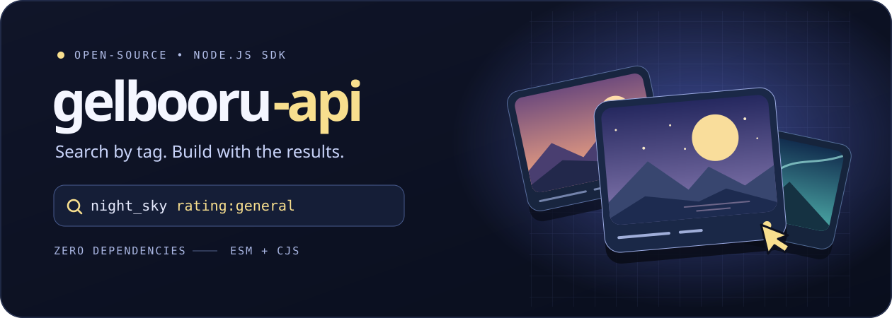

<div align="center">



# gelbooru-api

An unofficial Node.js client for the Gelbooru DAPI. Search posts by tag, look up IDs, and query tags or users without installing a runtime dependency.

[](https://www.npmjs.com/package/gelbooru-api)
[](https://nodejs.org/)
[](LICENSE)
[](https://github.com/slpkbt/gelbooru-api/actions/workflows/ci.yml)

</div>

## Preview


The artwork and results in this demo are illustrative. This package is an SDK, not the gallery UI shown above.

## Quick start

This README documents the **2.0** API. Until 2.0 is on npm, install the current source with `npm install /path/to/checkout` rather than expecting the published 1.x package to have these features.

```js
import Gelbooru from 'gelbooru-api';
// CommonJS: const Gelbooru = require('gelbooru-api');

const client = new Gelbooru({
  apiKey: process.env.GELBOORU_API_KEY, // optional, when anonymous access is allowed
  userId: process.env.GELBOORU_USER_ID,
  timeoutMs: 10_000
});

const result = await client.searchPosts({
  tags: ['landscape', 'rating:general'],
  limit: 8,
  page: 0
});

console.log(result.posts.map(({ id, tags }) => ({ id, tags })));
```

- **Node.js 22+** with built-in Fetch; ESM and CommonJS, both with TypeScript declarations.
- **Pagination:** page numbers start at zero; total is `null` when upstream doesn't report it.
- **Server-side only:** don't expose API credentials in browser bundles, screenshots or request logs.
- **No surprises:** requests use the documented Gelbooru HTTPS endpoint, do not follow redirects, and do not automatically retry.

## API

| Method | Result |
| :-- | :-- |
| `searchPosts({ tags, limit, page, signal })` | `{ posts, page, limit, total }`; an empty search returns an empty array in `posts`. |
| `getPosts(tags?, limit?, pid?)` | Post list; also sets the legacy `lastPosts` field. |
| `getRandomPost(tags?)` | One post, using the server’s random sort. |
| `getPostById(id)` | Single-item post list. |
| `getTags(limit?, orderBy?, afterId?)` | Tag list. Sort by `count`, `date`, or `name`. |
| `searchTags(tags?)`, `getTagById(id)` | Tag list. |
| `searchUser(name?, limit?)` | User list. |

The old methods retain the `{ success: false, message }` sentinel for known empty results. Post fields are passed through without guessing missing metadata.

## Credentials and errors

Gelbooru can require authentication or throttle requests. Use your own API key and user ID from the account settings, supplying both or neither. See the [official DAPI docs](https://gelbooru.com/index.php?id=18780&page=wiki&s=view).

Catch the exported `GelbooruError` and inspect `code`, optional `status`, and optional `retryAfter`. `AUTH` means the request was denied or credentials were requested; `RATE_LIMIT` means the upstream throttled the caller. `TIMEOUT`, `ABORTED`, `NETWORK`, `HTTP`, `UPSTREAM`, and `INVALID_RESPONSE` distinguish the other failure modes. Invalid local options throw `TypeError` or `RangeError`.

The site may contain mature content. Examples use `rating:general`; upstream ratings are not a guarantee. Check [Gelbooru’s terms](https://gelbooru.com/tos.php) and the rights to any artwork before displaying or reusing it. This project is not affiliated with Gelbooru.

## Upgrading from 1.x

- `new Gelbooru('tag_a,tag_b', 10)`, `require('gelbooru-api')`, and the legacy method names still work.
- The legacy constructor now respects the limit argument. Invalid limits, IDs, and pages are rejected rather than producing ambiguous queries.
- Network, API and decoding failures now reject instead of looking like empty search results. Only `getPosts` updates `lastPosts`; use the returned page for new code.
- The old mutable `baseUrl` is intentionally not supported. Use the `fetch` option for a test stub or custom server-side transport.
- `request` is no longer needed; minimum Node.js is 22.

## Development

```sh
npm ci
npm test
npm pack --dry-run
```

Fixture-based tests make no calls to Gelbooru. To try a real request with your own authorized credentials, run `node examples/search.mjs`. To report an issue, never paste request URLs containing credentials.
